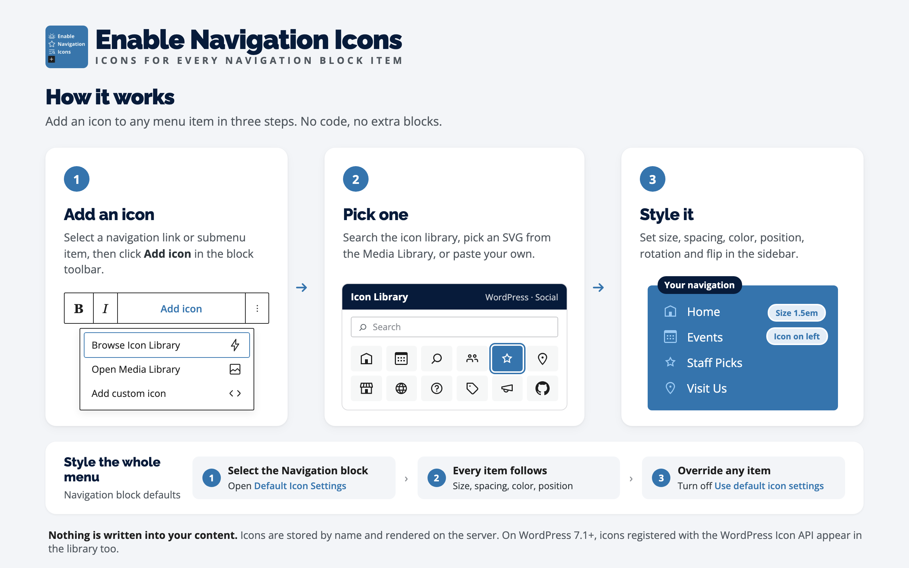
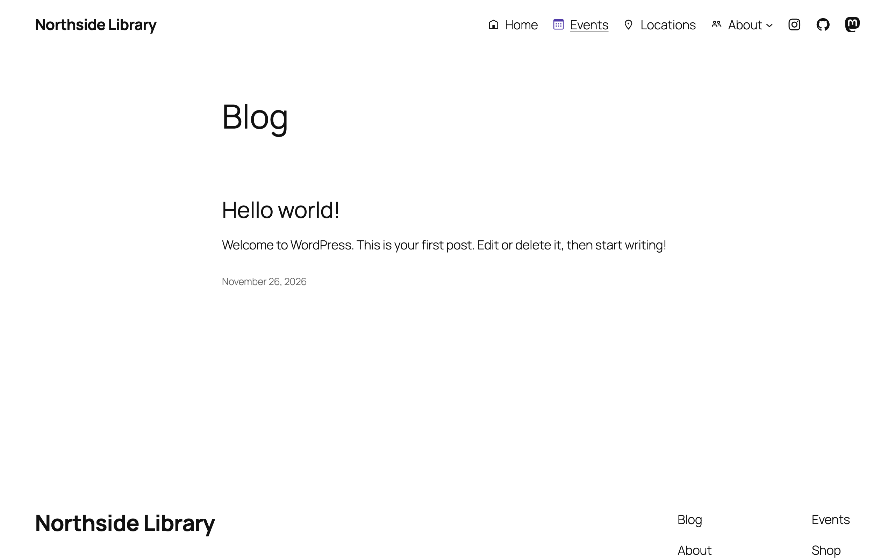
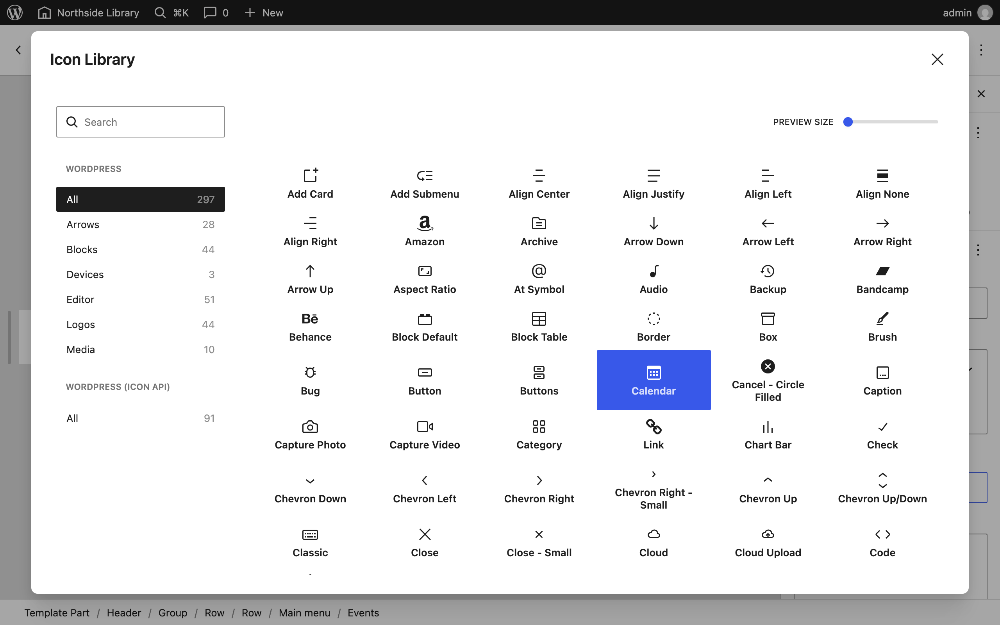
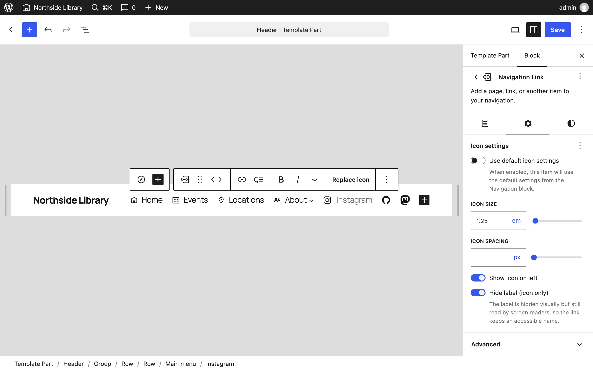
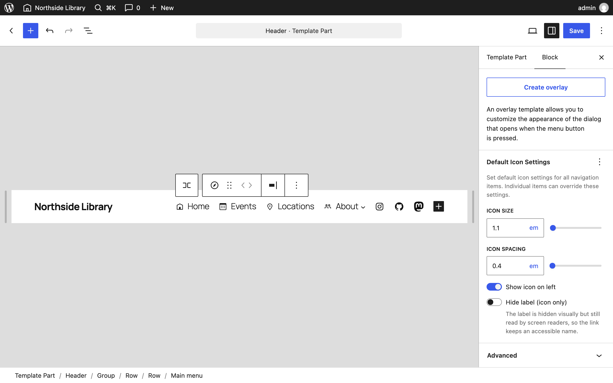

# Enable Navigation Icons

Add icons to the items in the core Navigation block. Pick from 297 built-in icons, the WordPress Icon API or your own SVG, then style them per item or once for the whole menu.



**[Try it in WordPress Playground](https://playground.wordpress.net/?blueprint-url=https://raw.githubusercontent.com/bmx269/enable-navigation-icons/main/blueprint.json)** to test the plugin in your browser, with nothing to install.

- **WordPress.org:** [wordpress.org/plugins/enable-navigation-icons](https://wordpress.org/plugins/enable-navigation-icons/)
- **Requires:** WordPress 6.9+, PHP 7.4+ (WordPress 7.1+ for the Icon API features)
- **License:** GPLv2 or later
- **Author:** [Trent Stromkins](https://github.com/bmx269)

## Getting started

1. **Select a menu item.** In the Site Editor or the block editor, select a link or submenu inside a Navigation block.
2. **Add an icon.** Click **Add icon** in the block toolbar and choose from the icon library, paste SVG code, or pick an SVG from the Media Library if your site allows SVG uploads.
3. **Style the whole menu.** Select the Navigation block and set **Default Icon Settings** in the sidebar. Every item follows them.
4. **Override where needed.** On any item, turn off **Use default icon settings** to give it its own settings and colors.



## Features

- **Icons from anywhere:** 297 built-in icons, icons registered with the WordPress Icon API (7.1+), custom SVG code, Media Library SVGs, and icon sets registered for the [Icon Block](https://wordpress.org/plugins/icon-block/) plugin
- **Layout:** icon before or after the label, icon-only items that screen readers still announce, space-between layout, top/center/bottom alignment, vertical offset, size and gap
- **Style:** palette or custom icon color, a separate color on hover and keyboard focus, rotation, flipping, and "no icon fill" for stroke icon sets such as Lucide
- **Menu-wide defaults:** set everything once on the Navigation block; items inherit it or use their own settings
- **Core-style panels:** settings use `ToolsPanel` like core's block settings, with per-option reset and "Reset all"
- **Supported blocks:** `core/navigation-link`, `core/navigation-submenu` and Ollie Menu Designer's `ollie/mega-menu`, with defaults on `core/navigation`

| Icon library | Per-item settings | Menu defaults |
|---|---|---|
|  |  |  |

## Installation

1. In **Plugins → Add New Plugin**, search for "Enable Navigation Icons" and install it. You can also download it from [WordPress.org](https://wordpress.org/plugins/enable-navigation-icons/), or upload the zip via **Plugins → Add New Plugin → Upload Plugin**.
2. Activate the plugin from the **Plugins** screen.
3. Follow **Getting started** above.

## How it works

- **Rendered, not saved.** Icons are injected by `render_block` filters when the page is rendered, so post content and templates never contain icon markup. Requests made through the REST API are skipped, so editor autosaves can't capture it either.
- **Stored by name.** Library picks store only `iconName`: `enable-navigation-icons/<name>` for the built-in set, resolved from `build/icons/<name>.svg` on any supported version, or a registry name such as `core/plus`, resolved with `wp_get_icon()` on 7.1+. Custom SVG and Media Library icons are stored in the `icon` attribute and sanitized with `wp_kses()` on output.
- **Icon API (7.1+).** The built-in set is registered as the `enable-navigation-icons` collection by file path, so core only reads and sanitizes an icon when it is first used. The editor loads core's collections over REST only when the library is opened or an item uses a registry icon.
- **Defaults.** The Navigation block's attributes are captured on `render_block_data` and applied to every child item it renders, including items from a saved `wp_navigation` menu.
- **Markup.** The icon `<span class="wp-block-navigation-item__icon">` is inserted inside the item's link or submenu button through a `WP_HTML_Tag_Processor` subclass. Settings become classes on the `<li>`, such as `has-icon__wordpress-github`, `has-icon-position__left` and `has-hidden-label`, which themes can target.

[CLAUDE.md](CLAUDE.md) documents the attributes, hooks and classes in full.

## Development

```bash
npm install
npm start            # watch build
npm run build        # production build, also regenerates build/icon-manifest.php and build/icons/
npm run lint:js
npm run lint:css
npm run playground   # WordPress Playground with the plugin mounted
```

The WordPress.org screenshots are made from [`.wordpress-org-src/`](.wordpress-org-src/): screenshot 1 is drawn, and 2–8 are captured from a Playground site with `capture.cjs`.

## Releasing

Publishing a GitHub release runs [`deploy.yml`](.github/workflows/deploy.yml), which builds the plugin and deploys it, with the `.wordpress-org/` assets, to WordPress.org SVN. Before releasing, bump the version in `package.json`, the plugin header and the readme's Stable tag, and add a changelog entry to `readme.txt`. Files listed in `.distignore` are left out of the package.

## Support & Contribute

- **Support:** [WordPress.org support forum](https://wordpress.org/support/plugin/enable-navigation-icons/)
- **Bugs and feature requests:** [GitHub issues](https://github.com/bmx269/enable-navigation-icons/issues)
- **Contribute:** pull requests are welcome against `main`.

## Acknowledgments

Inspired by, and built on code and ideas from, [Enable Button Icons](https://github.com/ndiego/enable-button-icons) by Nick Diego.

## Changelog

See [readme.txt](readme.txt#changelog).
